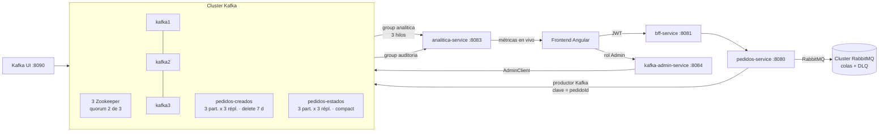

# Kafka en Pedidos360 (EP5 DSY1107)

Kafka **complementa** a RabbitMQ; no lo reemplaza. Las integraciones de RabbitMQ (colas, DLQ, exchanges
topic y direct, administrador) siguen funcionando sin cambios.

| | RabbitMQ (ya existente) | Kafka (nuevo) |
|---|---|---|
| Uso | Tareas que se procesan **una vez**: notificaciones, tickets, comprobantes | **Streaming**: registro ordenado y re-leíble de todos los eventos |
| Entrega | Cola: cada mensaje lo consume un solo consumidor, con ACK/NACK y DLQ | Log: cada consumer group lee todos los eventos con su propio offset |
| Retención | El mensaje se borra al confirmarse | Se conserva por tiempo (7 días) o por clave (compactado) |
| Consumidores | notificaciones, tickets, documentos | analitica (métricas), auditoria (historial) |

## 1. Arquitectura



### Zookeeper y brokers (docker-compose, perfil `kafka`)

- **3 nodos Zookeeper** (`zookeeper1..3`): guardan los metadatos del clúster (brokers vivos, líderes de
  partición, configuración de tópicos) y eligen al broker **controlador**. Funcionan por **quórum**: con 3
  nodos, el ensemble sigue operando si cae 1 (2 de 3 forman mayoría).
- **3 brokers** (`kafka1..3`): almacenan las particiones. Cada partición tiene **1 líder** (recibe lecturas
  y escrituras) y **2 seguidores** en otros brokers que replican los datos.
- **Tolerancia a fallos**: con `replication.factor=3` y `min.insync.replicas=2`, si cae un broker:
  - las particiones donde era líder eligen un nuevo líder entre las réplicas sincronizadas (ISR);
  - los productores (con `acks=all`) siguen escribiendo, porque quedan 2 réplicas en sincronía;
  - `unclean.leader.election.enable=false` impide elegir como líder a una réplica desactualizada, así que no
    se pierden datos.
- **Listeners**: `INTERNAL://kafkaN:9092` (entre contenedores) y `EXTERNAL://localhost:2909N` (desde el host).
- `auto.create.topics.enable=false`: los tópicos solo se crean de forma controlada (kafka-init o la API admin).

## 2. Tópicos y parámetros de administración

| Tópico | Particiones | Réplicas | cleanup.policy | Retención | min.insync.replicas | Por qué |
|---|---|---|---|---|---|---|
| `pedidos-creados` | 3 | 3 | `delete` | 7 días | 2 | Historial para la analítica semanal; lo antiguo se descarta |
| `pedidos-estados` | 3 | 3 | `compact` | por clave | 2 | Kafka conserva el **último estado de cada pedido**: un consumidor nuevo reconstruye el estado actual |
| `pedidos-creados.DLT` / `pedidos-estados.DLT` | 3 | 3 | `delete` | 14 días | – | Mensajes fallidos para investigar |

- **3 particiones**: hasta 3 consumidores de un mismo grupo procesan en paralelo (un hilo por partición).
- **Clave = id del pedido**: todos los eventos de un pedido caen en la misma partición, por lo que se consumen
  **en orden** (PENDIENTE → ENVIADO → ENTREGADO).
- Se definen en dos lugares coherentes: `kafka/crear-topicos.sh` (kafka-init) y `KafkaTopicosConfig`
  (`NewTopic` en pedidos-service, valores en `app.kafka.*`).

## 3. Diseño de los eventos

```json
// pedidos-creados  (cabecera __TypeId__ = pedidoCreado)
{ "eventoId": "8f1c...", "version": 1, "timestamp": "2026-11-26T10:15:00Z",
  "pedidoId": 42, "cliente": "a***@empresa.cl", "descripcion": "Notebook",
  "total": 599990, "estado": "PENDIENTE" }

// pedidos-estados  (cabecera __TypeId__ = estadoCambiado)
{ "eventoId": "b72e...", "version": 1, "timestamp": "2026-11-26T10:20:00Z",
  "pedidoId": 42, "estadoAnterior": "ENVIADO", "estadoNuevo": "ENTREGADO", "total": 599990 }
```

| Campo | Para qué |
|---|---|
| `eventoId` | Identificador único: el consumidor descarta duplicados (entrega *at-least-once* + idempotencia) |
| `version` | Permite evolucionar el contrato sin romper a los consumidores |
| `timestamp` | Momento del hecho (ISO-8601 UTC), para ordenar y medir |
| `pedidoId` | Clave del mensaje: orden por pedido y compactación |
| `cliente` | Email **enmascarado** (Ley 21.719: minimización de datos personales) |
| `total` | Lo necesita la analítica de ventas sin consultar la base de datos |
| `estadoAnterior` / `estadoNuevo` | Mover el pedido entre contadores (pendientes, enviados, entregados) |

El tipo viaja como **alias** en la cabecera `__TypeId__` (`spring.json.type.mapping`): productor y consumidor
no comparten clases Java, solo el contrato.

## 4. Productor (pedidos-service)

`PedidoKafkaProducer` publica al crear un pedido y al cambiar su estado (`PedidoService`), además de RabbitMQ.

| Propiedad | Valor | Motivo |
|---|---|---|
| `acks` | `all` | El evento se confirma cuando lo tienen las réplicas en sincronía (≥ 2) |
| `enable.idempotence` | `true` | Los reintentos no duplican ni desordenan |
| `retries` / `delivery.timeout.ms` | 10 / 30 s | Reintenta ante caídas breves de un broker |
| `max.block.ms` | 3 s | Si el clúster no responde, la petición HTTP no se bloquea |
| `linger.ms` / `batch-size` / `compression-type` | 10 ms / 32 KB / gzip | Rendimiento ante volumen alto |
| `key/value-serializer` | String / JsonSerializer | Clave = id del pedido; valor = DTO en JSON |

Si Kafka no está disponible, el pedido **igual se guarda** y el error queda en el log (no se rompe el negocio).

## 5. Consumidores (analitica-service)

| Listener | Tópicos | Consumer group | Concurrencia | Qué hace |
|---|---|---|---|---|
| `PedidoEventosListener.onPedidoCreado` | pedidos-creados | `analitica` | 3 | Suma pedidos, ventas y ticket promedio |
| `PedidoEventosListener.onEstadoCambiado` | pedidos-estados | `analitica` | 3 | Mueve el pedido entre estados |
| `AuditoriaListener.auditar` | ambos | `auditoria` | 1 | Registra todos los eventos |

- **Separación de responsabilidades**: el listener solo recibe, valida (`ValidadorEventos`) y delega en
  `AnaliticaService` / `AuditoriaService`, que no conocen Kafka.
- **Consumer groups**: `analitica` y `auditoria` reciben **cada uno** todos los eventos (publicar/suscribir) y
  avanzan con offsets independientes. Dentro de `analitica`, las 3 particiones se reparten entre los hilos; si se
  levanta una segunda instancia, Kafka rebalancea las particiones entre ambas (`CooperativeStickyAssignor`).
- **Offsets**: `enable-auto-commit=false` y `ack-mode=record`: el offset se confirma después de procesar
  (*at-least-once*); los duplicados se descartan por `eventoId`.
- `auto-offset-reset=earliest`: un grupo nuevo lee desde el inicio (reconstruye las métricas).

### Manejo de errores

1. `ErrorHandlingDeserializer`: un JSON corrupto no rompe el consumidor.
2. `DefaultErrorHandler`: errores transitorios se **reintentan 3 veces** con espera exponencial (1 s, 2 s, 4 s).
3. Eventos inválidos (`EventoInvalidoException`, Bean Validation) **no se reintentan**.
4. Al agotar reintentos, o si el evento es inválido, `DeadLetterPublishingRecoverer` lo envía a
   `<tópico>.DLT` en la misma partición, con log contextual (tópico, partición, offset, clave y motivo). El
   consumo continúa con el siguiente mensaje.

## 6. Administración (kafka-admin-service, rol Admin)

| Método | Endpoint | Operación |
|---|---|---|
| GET | `/api/kafka/topicos` | Listar tópicos (particiones, réplicas) |
| GET | `/api/kafka/topicos/{nombre}` | Detalle: líder, réplicas e ISR por partición y configuración |
| POST | `/api/kafka/topicos` | Crear (particiones, réplicas, retención, cleanup policy, min.insync) |
| PUT | `/api/kafka/topicos/{nombre}/configuracion` | Modificar retención, cleanup policy, min.insync, max.message.bytes |
| POST | `/api/kafka/topicos/{nombre}/particiones` | Aumentar particiones |
| DELETE | `/api/kafka/topicos/{nombre}` | Eliminar (los del sistema están protegidos: 409) |
| GET | `/api/kafka/consumer-groups` | Grupos con estado, miembros y particiones asignadas |
| GET | `/api/kafka/consumer-groups/{grupo}/lag` | Lag por partición (log-end-offset − offset confirmado) |
| POST | `/api/kafka/consumer-groups/{grupo}/reset-offsets` | Reposicionar a `earliest`/`latest` (grupo detenido) |

Todas las operaciones tienen timeout, validación de entrada y log de auditoría (`AUDITORIA`).

## 7. Cómo levantarlo y demostrarlo

```bash
cp .env.example .env    # completar claves
docker compose --profile app --profile kafka up -d --build
```

| Servicio | URL |
|---|---|
| Kafka UI | http://localhost:8090 |
| analitica-service | http://localhost:8083/actuator/health |
| kafka-admin-service | http://localhost:8084/actuator/health |
| Frontend (`npm start`) | http://localhost:4200 → "Analítica en vivo" y "Kafka" |

**Demostraciones:**

1. **Tiempo real**: abrir "Analítica en vivo", crear un pedido en otra pestaña → los contadores cambian en ~3 s.
   En Kafka UI → Topics → pedidos-creados → Messages se ve el evento con su partición y offset.
2. **Tolerancia a fallos**: `docker stop kafka2` → crear y entregar pedidos (todo sigue funcionando). En
   Kafka UI las particiones de kafka2 cambian de líder y el ISR baja a 2. Luego `docker start kafka2`.
3. **Lag**: `docker stop pedidos360-backend-analitica-service-1` → crear 5 pedidos → Kafka UI → Consumers →
   `analitica` muestra lag 5 (o en la vista Kafka → "Ver lag") → `docker start ...` → el lag vuelve a 0 y la
   analítica se pone al día.
4. **Consumer groups independientes**: el grupo `auditoria` tiene lag 0 aunque `analitica` esté detenido.
5. **Compactación**: `pedidos-estados` conserva el último estado de cada pedido (clave = id).
6. **DLT**: un mensaje inválido termina en `pedidos-creados.DLT` sin detener el consumo.

Comandos CLI útiles:

```bash
docker compose exec kafka1 kafka-topics --bootstrap-server kafka1:9092 --describe --topic pedidos-creados
docker compose exec kafka1 kafka-consumer-groups --bootstrap-server kafka1:9092 --describe --group analitica
docker compose exec kafka1 kafka-console-consumer --bootstrap-server kafka1:9092 --topic pedidos-estados --from-beginning --property print.key=true
```

> En producción el tráfico de Kafka debería ir cifrado y autenticado (SASL_SSL + ACL). En el entorno local se
> usa PLAINTEXT dentro de la red de Docker.
