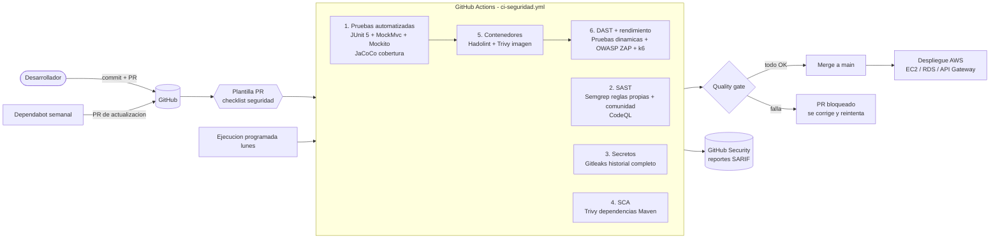

# Seguridad y calidad - Pedidos360 (EP5)

Este documento describe los controles de seguridad automatizados del backend, como se integran en el
ciclo de desarrollo, con que norma se relaciona cada uno y como se mantiene la calidad en el tiempo.

## 1. Pipeline DevSecOps con controles automatizados



| # | Control | Herramienta | Que detecta | Criterio del quality gate |
|---|---|---|---|---|
| 1 | Pruebas funcionales, de seguridad e integracion | JUnit 5, MockMvc, Mockito, Spring Security Test | Regresiones, fallas de autenticacion/autorizacion, validacion | 100 % de pruebas aprobadas |
| 1 | Cobertura | JaCoCo | Codigo no probado | Reporte en cada ejecucion |
| 2 | SAST | Semgrep (`.semgrep/` + `p/java`, `p/owasp-top-ten`) y CodeQL | Inyeccion, asignacion masiva, credenciales en codigo, datos personales en logs | 0 hallazgos de severidad ERROR |
| 3 | Deteccion de secretos | Gitleaks | Claves, tokens y contrasenas en cualquier commit | 0 secretos |
| 4 | SCA | Trivy (fs) | Dependencias con CVE conocidos | 0 CVE CRITICAL con parche |
| 5 | Seguridad de contenedores | Hadolint, Trivy (imagen) | Malas practicas en Dockerfile, CVE del sistema base | 0 errores Hadolint, 0 CRITICAL con parche |
| 6 | DAST | Script `pruebas-seguridad-dinamicas.sh`, OWASP ZAP baseline | JWT falsificado, cabeceras, CORS, exposicion de actuator, trazas | 100 % pruebas dinamicas aprobadas |
| 6 | Rendimiento | k6 | Degradacion de tiempos de respuesta | p95 < 500 ms y < 1 % errores |

## 2. Controles en la arquitectura en ejecucion

```mermaid
flowchart LR
    U([Usuario]) -->|HTTPS| FE[Angular<br/>MSAL + CSP<br/>token en sessionStorage]
    FE -->|login OAuth2/OIDC| AAD[(Azure AD<br/>IDaaS)]
    FE -->|JWT Bearer| BFF[bff-service<br/>valida JWT, scope y rol<br/>lista blanca de rutas<br/>timeouts]
    BFF -->|JWT| PS[pedidos-service<br/>@PreAuthorize<br/>DTO + Bean Validation<br/>errores sin trazas<br/>auditoria]
    PS --> DB[(PostgreSQL RDS<br/>credenciales por variable<br/>ddl validate)]
    PS -->|eventos| MQ[(RabbitMQ cluster<br/>DLQ, ACK manual)]
    MQ --> CONS[Consumidores<br/>emails enmascarados en logs]
    FE -->|JWT rol Admin| RA[rabbit-admin-service<br/>recursos protegidos]
    RA --> MQ
```

## 3. Trazabilidad normativa y legal

| Control implementado | OWASP Top 10 2021 / ASVS 4.0 | ISO/IEC 27001:2022 (Anexo A) | Marco legal Chile |
|---|---|---|---|
| Autenticacion con Azure AD (OIDC) y validacion de JWT en cada servicio | A07, ASVS V2/V3 | A.5.15, A.8.5 | Ley 21.663 (medidas de seguridad) |
| Autorizacion por scope `Pedidos.Access` y rol `Admin` | A01, ASVS V4 | A.5.15, A.8.3 | Ley 21.719 (acceso restringido a datos) |
| DTO + Bean Validation, enum de estados (sin asignacion masiva) | A03/A04, ASVS V5 | A.8.28 | - |
| Errores sin trazas, codigo de incidente | A05, ASVS V7.4 | A.8.28 | - |
| Cabeceras HTTP (CSP, HSTS, X-Frame-Options, nosniff) | A05, ASVS V14.4 | A.8.9 | - |
| CORS restringido al frontend | A05, ASVS V14.5 | A.8.20 | - |
| Sin credenciales por defecto; secretos por variables de entorno | A07, ASVS V2.10 / V6.4 | A.5.17, A.8.4 | Ley 21.663 |
| Enmascaramiento de emails en logs | A09, ASVS V7.1 | A.8.11, A.5.34 | Ley 19.628 / Ley 21.719 (minimizacion) |
| Log de auditoria (quien crea, cambia y elimina) | A09, ASVS V7.2 | A.8.15 | Ley 21.719 (responsabilidad proactiva) |
| SCA + Dependabot | A06 | A.8.8 | Ley 21.663 (gestion de vulnerabilidades) |
| SAST, secretos, DAST en cada cambio | A04/A05 | A.8.25, A.8.29 | - |
| Contenedores sin root, solo JRE, read-only | A05 | A.8.9 | - |
| Pruebas de rendimiento | - (ISO/IEC 25010: eficiencia) | A.8.6 | - |

## 4. Plan de mantenimiento

Ver [plan-mantenimiento.md](plan-mantenimiento.md).
